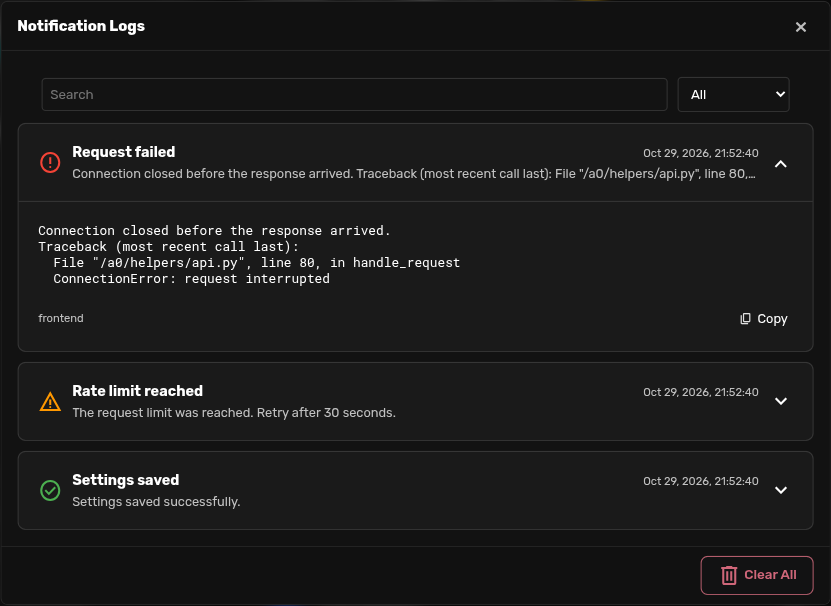

# Notification Logs

Keep the errors that disappear from Agent Zero's notification list. Open the bell, select **Logs**, and find or copy the full notification later.



## Install

In Agent Zero, open **Plugins → Install** and use:

```text
https://github.com/3clyp50/a0-notification-logs
```

Requires the Agent Zero `ready` frontend with the `notification_received` and `notification-header-actions-start` extension points. Core support is provided by [agent0ai/agent-zero#1986](https://github.com/agent0ai/agent-zero/pull/1986) (commit `c9d61ed3`). Install on a version containing that change; older frontends do not have the capture hook or Logs button slot. Reload the WebUI after installation or toggling the plugin. No keys, dependencies, configuration, or paid services are needed.

## Use

1. Open **Notifications** from the bell and select **Logs**. The button works even when the current notification list is empty.
2. Search or choose a severity. Expand an entry to read its message and details.
3. Select **Copy** to copy the timestamp, severity, source, title, message, and details.
4. **Clear All → Confirm** removes the log in this browser. Clearing ordinary notifications does not erase this history.

The newest 100 entries are shown first; **Show more** reveals the next page. Entries update across tabs of the same origin.

## Storage and scope

- Stores the latest **1,000 notification events** in IndexedDB, database `a0_notification_logs`. Oldest entries are removed as new ones arrive. Long messages are preserved without truncation.
- Records both backend notifications delivered to the WebUI and frontend-only toasts, including connection errors. Replayed snapshots are deduplicated. Updated backend notifications with a new timestamp are separate events.
- History survives reloads and normal browser restarts. It is local to the browser profile and exact origin (scheme, host, and port); different addresses and devices have separate histories. Private browsing or clearing site data may remove it.
- Captures events while an enabled WebUI is open. It cannot recover frontend errors from before installation or capture server events that are no longer in the server's snapshot when a browser reconnects. This is notification history, not a Python, chat, or terminal log.
- Messages and details are converted to plain text. Embedded buttons, scripts, styles, and icon markup are excluded. Nothing is sent to an external service.
- Notifications can contain paths or other sensitive information already shown by Agent Zero. This plugin retains that text in the browser profile; review copied logs before sharing them.
- If browser storage fails or runs out of space, a notification explains that new entries are kept only until the page closes. The in-memory fallback retains at most 1,000 entries. Existing stored history is not deleted to hide a storage failure.
- Clearing records also saves a timestamp boundary, so old server snapshots do not repopulate the log. Server and browser timestamp boundaries are kept separately to handle clock differences.

## Disable or uninstall

Disable or remove the plugin through **Plugins**, then reload the WebUI. There are no backend processes, dependencies, installation hooks, or generated server files to clean up.

Browser history is intentionally retained so reinstalling restores it. To remove it, use **Logs → Clear All** before uninstalling in each browser/address you used. After uninstalling, remove the site's browser data, or delete only the `a0_notification_logs` IndexedDB database in browser developer tools. The latter also removes the clear-history timestamp boundary.

## Development

The plugin lives at the repository root and installs as `usr/plugins/notification_logs`. Its browser tests use local Agent Zero assets and isolated browser profiles; they do not connect to a running instance or use credentials.

With pytest, Playwright, and a Playwright Chromium browser already available:

```bash
A0_ROOT=/path/to/agent-zero pytest tests -q
```

The UI uses Agent Zero's modal shell, fonts, theme variables, icons, copy feedback, and confirmation control. UI design was developed with an Opus consultation through the Agent Zero LLM API; the installed plugin makes no model calls.

## License

MIT. This is a community plugin for Agent Zero.
